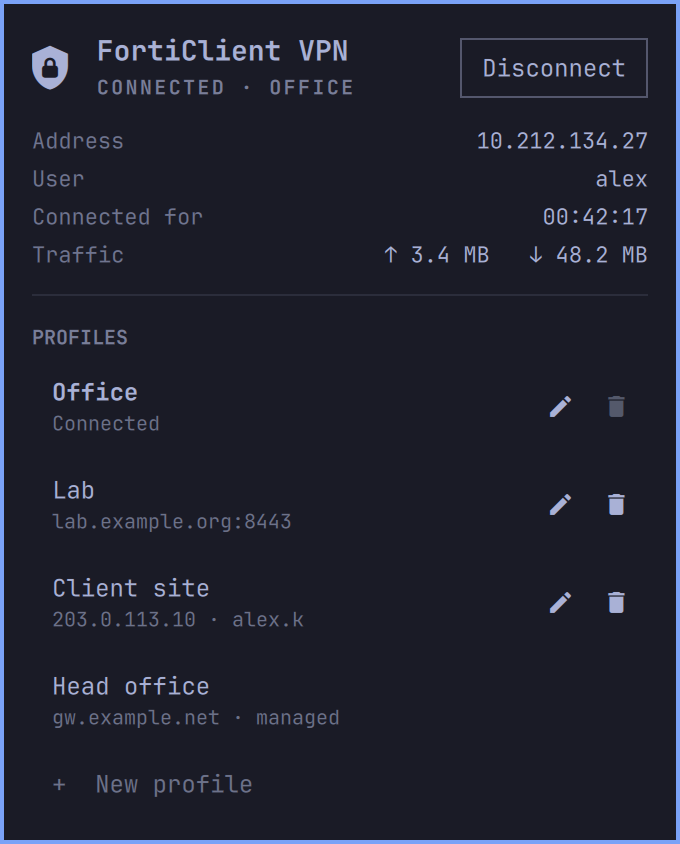

# FortiClient VPN for Omarchy

A small [Omarchy](https://omarchy.org) bar widget for Fortinet's own free FortiClient VPN client. Click the shield in the bar to connect and disconnect, create and edit profiles, and save your username or password, without opening the FortiClient window. It drives FortiClient itself rather than `openfortivpn`, so profiles, saved passwords and FortiClient's own options stay shared with the FortiClient window.

This is an unofficial plugin, not affiliated with or endorsed by Fortinet. FortiClient is a trademark of Fortinet, Inc.



## Features

- **Bar icon** that shows the VPN state: bright when connected, dimmed when not, pulsing while it connects. Hover for the profile and address.
- **Connect and disconnect** any profile. While connected, the panel shows the address, user, time connected and traffic.
- **Create, edit and remove profiles:** name, remote gateway, port, and whether the username is saved, asked each time, or not used at all (certificate-only).
- **Save password, Always up and Auto-connect**, the same options as in the FortiClient window.
- **FortiToken and other questions:** if FortiClient asks for a token code, a new password, a smart-card PIN, or whether to trust a server certificate, the question appears in the panel.
- **Keyboard and mouse:** connecting, answering FortiClient's questions and managing profiles all work from the keyboard; see [Keys](#keys). The Save password, Always up and Auto-connect switches are mouse-only.

## Privacy

- The plugin only talks to FortiClient on your machine, through FortiClient's own `forticlient vpn` command. It makes no network connections of its own and sends nothing anywhere.
- Your password goes from the password field straight to FortiClient, through a pipe. It is never put on a command line, in an environment variable or in a file, and the field is cleared once it's used.
- The plugin keeps no credentials or settings of its own. Profiles, saved usernames and saved passwords are all kept by FortiClient, exactly as if you'd used the FortiClient window. The only file it writes is the marker described under [Uninstall](#uninstall).

## Requirements

- Omarchy with the Quickshell-based `omarchy-shell`
- The free FortiClient VPN client: `forticlient-vpn` from the AUR (setup can install it)
- The FortiClient service (`forticlient.service`) running; setup can turn it on

Everything else (`python3`, `jq`, `gum`, `gdbus`, `notify-send`) comes with Omarchy.

## Install

```sh
omarchy plugin add https://github.com/fivefold3/omarchy-forticlient --enable
```

You're asked which bar section the icon goes in: left, center or right.

The first time the plugin loads, if FortiClient isn't installed, its service isn't running, or its tray icon is broken (see below), a notification offers a guided setup. Clicking it opens a terminal that asks before each step:

1. Install `forticlient-vpn` from the AUR, if it's missing.
2. Start the FortiClient service now and at every boot.
3. Fix FortiClient's own tray icon, if it's broken: turn it off, or install `gtk2`.
4. Choose (or change) the bar section for the icon.

Nothing changes if you dismiss or ignore the notification, and you're only asked once. Run the same setup any time:

```sh
~/.config/omarchy/plugins/io.github.fivefold3.forticlient/forticlient-vpn setup
```

## Root

The plugin itself never needs root. FortiClient does its VPN work in its own service, which runs as root, and that service has to be running. Starting it is the one step that asks for your password, through Omarchy's normal password prompt: in setup, which also asks whether it should start at every boot, or from the **Start** button the panel shows when the service is off, which starts it for this session only. Installing `forticlient-vpn` or `gtk2` also asks for your password, since they are system packages. FortiClient itself is proprietary software from Fortinet, installed from its AUR package.

## Keys

| Key | Action |
|---|---|
| `↑` `↓` / `j` `k` | Move between profiles |
| `Enter` / `Space` / click | Open a profile's connect form, then connect |
| `Enter` in a field | Connect, or save the profile |
| `e` | Edit the selected profile |
| `n` | New profile |
| `x` | Remove the selected profile (press twice) |
| `d` | Disconnect |
| `r` | Refresh |
| `y` / `n` | Answer a yes/no question from FortiClient |
| `Esc` | Close the form, cancel a connection that's waiting on a question, or close the panel |

Right-clicking the bar icon refreshes it.

To bind a key of your own, add a line like this to `~/.config/hypr/bindings.lua`:

```lua
o.bind("SUPER + ALT + V", "FortiClient VPN", "omarchy-shell forticlient toggle")
```

The shell also takes `omarchy-shell forticlient connect "<profile>"` (connects straight away when nothing needs typing, otherwise opens that profile's form), `disconnect` and `status`.

## Settings

| Setting | Default | |
|---|---|---|
| `refreshIntervalSec` | `10` | How often the icon checks the VPN while the panel is closed. While the panel is open, or while connecting, it checks every 2 seconds. |

Each check runs `systemctl is-active` and `forticlient vpn status` once, about 30 ms of CPU in all.

## Uninstall

```sh
omarchy plugin remove io.github.fivefold3.forticlient
```

That takes the icon out of the bar. FortiClient, its service and your profiles are left alone. To stop the service starting at boot, run `systemctl disable --now forticlient.service`. The plugin's only file outside its folder is the marker that remembers the setup offer was made: `~/.local/state/omarchy-forticlient/`. If you turned FortiClient's tray icon off in setup, delete `~/.config/autostart/Fortitray.desktop` to bring it back at the next login.

## How it works

- `Panel.qml` is the bar icon and panel.
- `forticlient-vpn` is a Bash script that runs `forticlient vpn ...` and reads its output. It also works on its own:

```sh
forticlient-vpn status        # key<TAB>value lines: installed, service, state, name, ip, ...
forticlient-vpn profiles      # one TSV line per profile
forticlient-vpn save <name> <gateway> <port> <prompt|save|none> [username]
forticlient-vpn remove <name>
forticlient-vpn connect <name> [-u user] [-p] [-s] [-a] [-w]
forticlient-vpn disconnect
forticlient-vpn start-service   # start the service for this session (setup can enable it at boot)
forticlient-vpn setup
```

`forticlient vpn connect` only reads a password from a terminal, so `connect` runs it on a pseudo-terminal through a short Python helper. The helper types the password in once the terminal has turned echo off, and passes any other question up to the panel. `connect` reports `status`, `prompt`, `error`, `info` and `done` lines.

It uses `forticlient vpn` rather than the older `fortivpn` command, which on the free edition only says that the trial has expired.

## Limitations

- **FortiClient's own tray icon needs `gtk2`.** `forticlient-vpn` lists `gtk2` only as optional, and it's in the AUR rather than the official repos. Without it, FortiClient's tray launcher restarts the tray every few seconds and fills the journal with `libgtk-x11-2.0.so.0` errors. This widget doesn't use the tray, so setup offers to turn the tray off (a user autostart override; nothing system-wide changes) or to install `gtk2` from the AUR, which builds from source.
- **Profile settings are the ones FortiClient's command line offers:** gateway, port and username. Client certificates, SAML single sign-on and the description are set in the FortiClient window (`forticlient gui`). Editing a profile here leaves its certificate setting as it was.
- **No renaming.** Create a new profile and remove the old one.
- **Corporate (EMS-managed) profiles** are listed and can be connected, but not edited or removed.

## License

MIT
